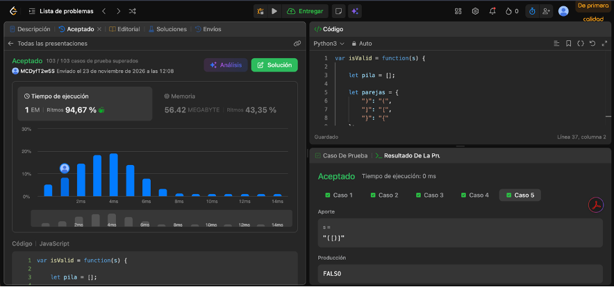
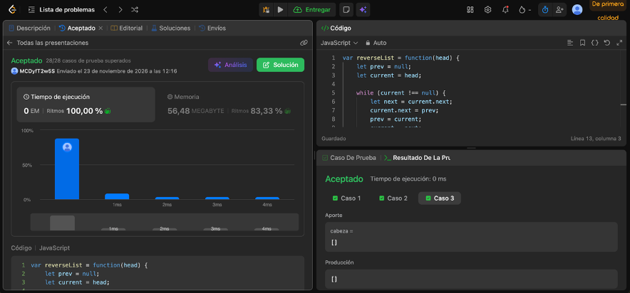
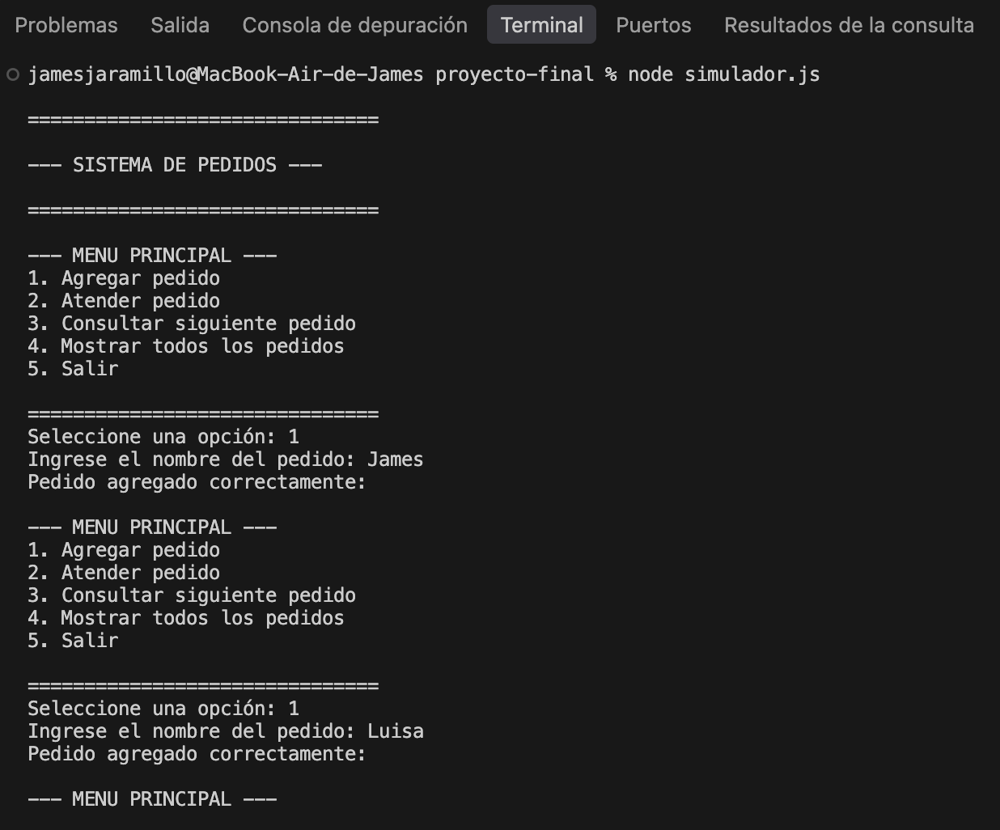
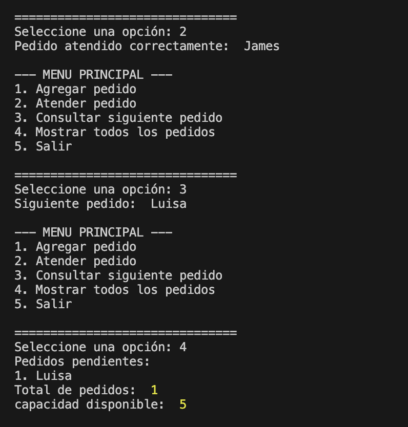
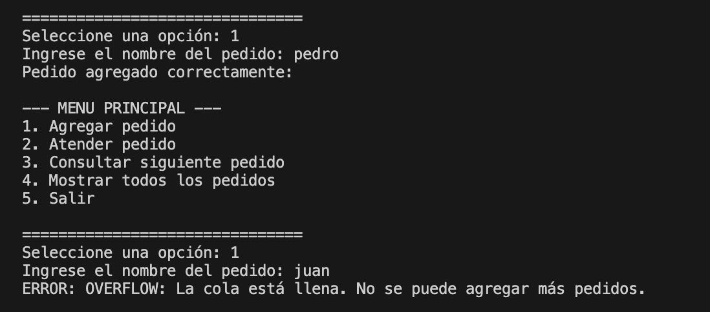
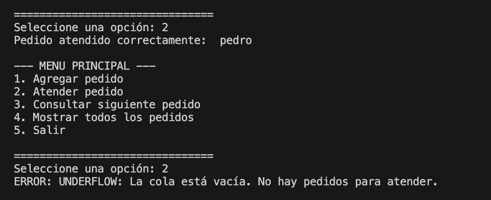

# Proyecto Final: Estructuras de Datos Lineales

**Programa:** Técnica Profesional en Programación de Software  
**Estudiante:** John James Jaramillo Prieto  
**Número de lista:** 7  
**Lenguaje de programación:** JavaScript  

## 1. Descripción del proyecto

Este proyecto consiste en desarrollar un simulador para la gestión de pedidos de un almacén, utilizando una estructura de datos lineal tipo Cola (Queue).

El sistema permite registrar pedidos, atenderlos en orden de llegada, consultar el siguiente pedido y visualizar los pedidos pendientes.

Se utiliza el principio FIFO (First In, First Out), que significa que el primer pedido en ingresar es el primero en ser atendido.

## 2. Capacidad máxima

Para determinar la capacidad máxima se utiliza el número de lista del estudiante:

- N = 7
- Fórmula: capacidadMax = (N mod 4) + 3
- Operación: (7 mod 4) + 3
- **Capacidad máxima = 6 pedidos**

El sistema no permite registrar más pedidos cuando alcanza su capacidad máxima. Tampoco permite atender pedidos cuando la cola está vacía.

## 3. Estructura de datos utilizada

Se implementó una Cola (Queue), siguiendo el principio FIFO.

Las principales operaciones son:

- **Encolar:** agrega un pedido al final de la cola.
- **Desencolar:** atiende y elimina el primer pedido.
- **Consultar:** muestra cuál es el siguiente pedido que será atendido.
- **Mostrar:** presenta todos los pedidos pendientes.

## 4. Problemas resueltos en LeetCode

### Problema 1: Valid Parentheses

- Plataforma: LeetCode.
- Dificultad: Easy.
- Estructura utilizada: Stack (Pila).
- Complejidad temporal: O(n).
- Complejidad espacial auxiliar: O(n).
- Resultado: Accepted.

### Problema 2: Reverse Linked List

- Plataforma: LeetCode.
- Dificultad: Easy.
- Estructura utilizada: Linked List (Lista enlazada).
- Complejidad temporal: O(n).
- Complejidad espacial auxiliar: O(1).
- Resultado: Accepted.

## 5. Análisis de eficiencia algorítmica

En el simulador de la cola, las operaciones de agregar, atender y consultar el siguiente pedido tienen una complejidad temporal O(1), porque se utilizan referencias al primer y último nodo.

La visualización de todos los pedidos tiene una complejidad O(n), porque debe recorrer todos los elementos de la cola.

En los ejercicios de LeetCode se analizaron los tiempos y espacios utilizados por cada algoritmo, teniendo en cuenta la cantidad de elementos de entrada.

## 6. Estructura de archivos

```text
proyecto-final/
├── simulador.js
├── leetcode/
│   ├── validarParentesis.js
│   └── listaInvertida.js
├── evidencias/
│   ├── lista-invertida.png
│   ├── validar-parentesis.png
│   ├── simulador1.png
│   ├── simulador2.png
│   ├── overflow.png
│   └── underflow.png
│
└── README.md

```

## 7. Ejecución del simulador

Para ejecutar el programa se debe tener instalado Node.js.

Desde la terminal, dentro de la carpeta del proyecto, se ejecuta:

```bash
node simulador.js
```

El programa presenta un menú interactivo que permite agregar pedidos, atenderlos, consultar el siguiente pedido, mostrar la cola y salir.


## 8. Evidencias

### 8.1. Ejercicios de LeetCode

**Valid Parentheses**



**Reverse Linked List**



### 8.2. Simulador de pedidos

**Funcionamiento del simulador**






**Prueba de capacidad máxima (Overflow)**



**Prueba de cola vacía (Underflow)**




## 9. Conclusión

El desarrollo de este proyecto me permitió aplicar los conceptos de estructuras de datos lineales, especialmente las colas, pilas y listas enlazadas. También me permitió comprender la importancia de analizar la eficiencia de los algoritmos mediante la notación Big-O.